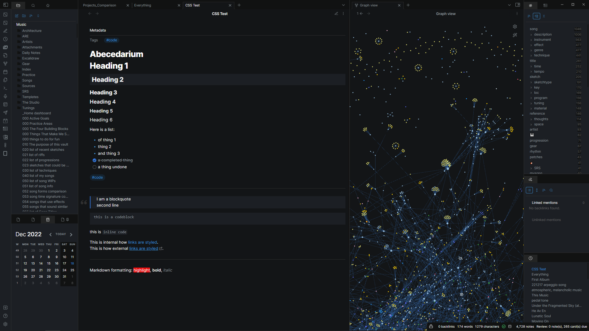
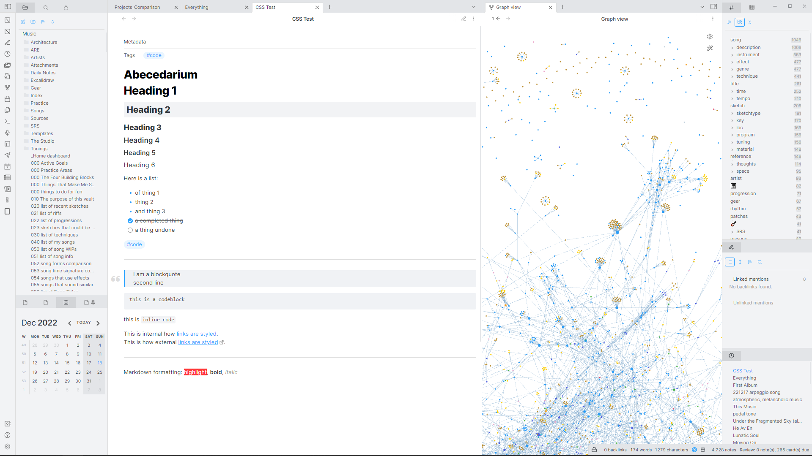

# Abecedarium
This is a theme for [Obsidian](https://obsidian.md). Designed for both dark and light modes, with a bright blue accent color. Secondary colors are tinted ever so slightly blue to complement the accent color. Edges are generally sharper than the default theme for a more minimal look. 

To install this theme, open Obsidian and go to Settings > Appearance > Themes, click the Manage button and search for it in the Community Themes list. 

